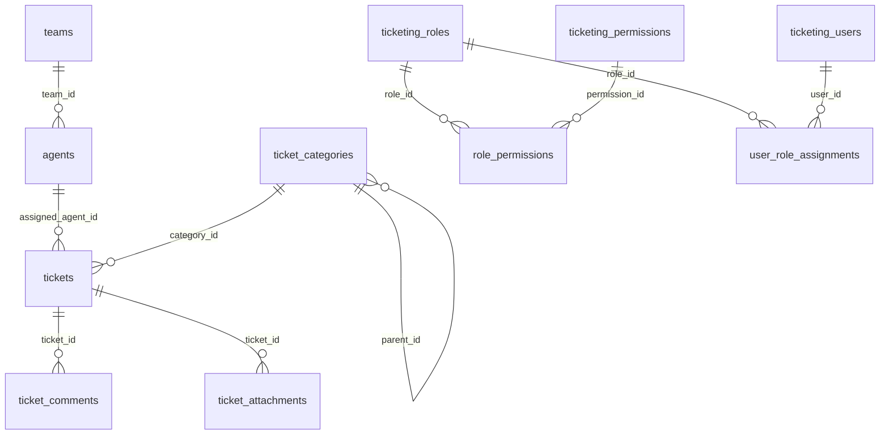

# Ticketing API Entity Relationship Diagram

This is the schema in `internal/ent/schema` and the versioned migrations `20261116090000_baseline.sql` and `20261116090100_phase0.sql`. Tables that do not exist yet are listed at the end with the sprint that adds them.

Conventions:

- UUID primary keys, except `role_permissions`, which uses a bigint identity.
- `tenant_id uuid NOT NULL` on every tenant table. Tenants live in auth-api, so `tenant_id` has no foreign key.
- Timestamps are `timestamptz`. Soft deletes use `deleted_at` where a table has it.
- User ids (`customer_id`, `author_id`, `uploaded_by`, `user_id`, `auth_service_user_id`) are auth-api user ids with no foreign key.
- Production also has the `pg_trgm` and `uuid-ossp` extensions. No column uses pgvector.

`ticket_sequences`, `sla_policies`, `business_calendars`, `routing_rules`, `kb_articles`, `outbox_events`, `ticket_rollups`, `ticket_rollup_dims`, `ticket_rollup_marks`, `csat_responses` and `rollup_watermarks` stand alone and relate by `tenant_id` only; `csat_responses.ticket_id` and `ticket_rollup_marks.id` hold a ticket id with no foreign key. `tickets.assigned_team_id` and `ticket_attachments.comment_id` are plain columns with no foreign key.

## Tickets

### tickets

| Column | Type | Notes |
|---|---|---|
| `id` | uuid | Primary key |
| `tenant_id` | uuid | Not null |
| `ticket_number` | varchar | Not null, `TKT-000001` style, unique per tenant |
| `customer_id` | uuid | Not null. The requester's auth user id, or a synthetic id for public and internal requesters |
| `assigned_agent_id` | uuid | FK `agents.id`, on delete set null |
| `assigned_team_id` | uuid | Team id, no FK |
| `category_id` | uuid | FK `ticket_categories.id`, on delete set null |
| `subject` | varchar | Not null |
| `description` | text | Not null |
| `status` | varchar | Default `new`. `new`, `open`, `in_progress`, `pending_customer`, `pending_internal`, `resolved`, `closed`, `cancelled` |
| `priority` | varchar | Default `normal`. `low`, `normal`, `high`, `urgent`, `critical` |
| `channel` | varchar | Default `web`. `web`, `email`, `api`, `chat`, `whatsapp`, `phone`, `internal` |
| `order_id` | uuid | Order reference in another service |
| `external_reference` | varchar | Caller's reference |
| `crm_contact_id`, `crm_lead_id` | uuid | marketflow CRM references |
| `sla_response_due_at`, `sla_resolution_due_at` | timestamptz | SLA deadlines |
| `sla_response_breached`, `sla_resolution_breached` | boolean | Default false |
| `sla_policy_id` | uuid | Policy that set the deadlines, no FK; the worker joins it |
| `sla_paused_at` | timestamptz | Set while a pending status stops the SLA clock |
| `sla_paused_minutes` | bigint | Default 0. Total paused minutes in the policy's clock |
| `sla_first_response_minutes`, `sla_resolution_minutes` | bigint | Elapsed minutes in the policy's clock, net of pauses; the SLA report averages them |
| `first_response_at`, `resolved_at`, `closed_at`, `reopened_at` | timestamptz | Lifecycle times |
| `escalation_level` | bigint | Default 0. Raised by the worker's escalation rules |
| `escalated_at` | timestamptz | Last escalation |
| `tags` | jsonb | String list |
| `metadata` | jsonb | Requester contact (`requester_name`, `requester_email`, `requester_phone`), `source`, `source_ref`, `category`, `contact_hash`, `sla_warnings` (target to warning time), `csat` (survey state: `token_hash`, `issued_at`, `expires_at`, `used_at`; the token itself is never stored) |
| `created_at`, `updated_at`, `deleted_at` | timestamptz | |

Indexes:

| Index | Columns |
|---|---|
| `ticket_tenant_id_ticket_number` | Unique `(tenant_id, ticket_number)`. Per-tenant ticket numbers; replaced the old global unique index on `ticket_number`. |
| `ticket_tenant_source_ref` | Unique expression index `(tenant_id, metadata->>'source', metadata->'source_ref'->>'type', metadata->'source_ref'->>'id')` where `metadata->'source_ref'->>'id' IS NOT NULL`. The internal create idempotency key. It exists only in the migration, since Ent cannot declare expression indexes. |
| `ticket_tenant_id_status`, `ticket_tenant_id_priority`, `ticket_tenant_id_customer_id`, `ticket_tenant_id_assigned_agent_id`, `ticket_tenant_id_assigned_team_id` | Tenant filters |
| `ticket_category_id`, `ticket_order_id`, `ticket_crm_contact_id`, `ticket_crm_lead_id`, `ticket_external_reference` | Lookups |
| `ticket_sla_response_due_at`, `ticket_sla_resolution_due_at` | Breach scan |
| `ticket_created_at`, `ticket_deleted_at` | |
| `ticket_tenant_id_resolved_at`, `ticket_tenant_id_first_response_at`, `ticket_tenant_id_sla_response_due_at`, `ticket_tenant_id_sla_resolution_due_at` | The analytics rollup rebuilds an hour from each moment; resolved_at also serves the live resolved today figure (sprint 12) |
| `ticket_updated_at_id` | `(updated_at, id)`, the rollup's cross-tenant read of changed tickets from its watermark (sprint 12) |
| `ticket_open_backlog` | Partial `(tenant_id, status, assigned_team_id, assigned_agent_id, category_id, channel, priority, sla_resolution_due_at, sla_paused_at)` where `deleted_at IS NULL AND status IN ('new', 'open', 'in_progress', 'pending_customer', 'pending_internal')`, written in Postgres' normalised form. The live backlog, overdue, unassigned and open per agent as index-only scans (sprint 12) |

### ticket_sequences

One counter row per tenant. The create transaction claims the next number with `INSERT ... ON CONFLICT (tenant_id) DO UPDATE ... RETURNING next_value`.

| Column | Type | Notes |
|---|---|---|
| `id` | uuid | Primary key |
| `tenant_id` | uuid | Not null, unique (`ticket_sequences_tenant_id_key`) |
| `next_value` | bigint | Default 0. The last number handed out |
| `updated_at` | timestamptz | |

### ticket_comments

| Column | Type | Notes |
|---|---|---|
| `id` | uuid | Primary key |
| `tenant_id` | uuid | Not null. Added in phase 0 and backfilled from the parent ticket |
| `ticket_id` | uuid | FK `tickets.id` |
| `author_id` | uuid | From the caller's token |
| `author_type` | varchar | Default `agent` |
| `comment_type` | varchar | Default `public`. `public`, `internal`, `system` |
| `content` | text | Not null |
| `content_html` | text | |
| `is_edited`, `edited_at` | boolean, timestamptz | |
| `mentions` | jsonb | Not filled yet (sprint 9) |
| `metadata` | jsonb | |
| `created_at`, `deleted_at` | timestamptz | |

Indexes: `ticketcomment_tenant_id_ticket_id`, `ticketcomment_ticket_id_created_at`, `ticketcomment_ticket_id_comment_type`, `ticketcomment_author_id`, `ticketcomment_deleted_at`.

### ticket_attachments

Records only. Upload, signed URLs and delete arrive in sprint 9.

| Column | Type | Notes |
|---|---|---|
| `id` | uuid | Primary key |
| `tenant_id` | uuid | Not null. Added in phase 0 and backfilled from the parent ticket |
| `ticket_id` | uuid | FK `tickets.id` |
| `comment_id` | uuid | Optional, no FK |
| `uploaded_by` | uuid | Not null |
| `filename`, `storage_key`, `content_type` | varchar | Not null |
| `file_size` | bigint | Not null |
| `url`, `url_expires_at` | varchar, timestamptz | |
| `metadata` | jsonb | |
| `created_at`, `deleted_at` | timestamptz | |

Indexes: `ticketattachment_tenant_id_ticket_id`, `ticketattachment_ticket_id`, `ticketattachment_comment_id`, `ticketattachment_uploaded_by`, `ticketattachment_deleted_at`.

### ticket_categories

| Column | Type | Notes |
|---|---|---|
| `id` | uuid | Primary key |
| `tenant_id` | uuid | Not null |
| `parent_id` | uuid | FK `ticket_categories.id`, on delete set null |
| `name`, `slug` | varchar | Not null, slug unique per tenant |
| `description` | text | |
| `icon` | varchar | |
| `sort_order` | bigint | Default 0 |
| `is_active` | boolean | Default true |
| `default_assignee_id` | uuid | |
| `created_at`, `updated_at` | timestamptz | |

## Agents and teams

### teams

| Column | Type | Notes |
|---|---|---|
| `id` | uuid | Primary key |
| `tenant_id` | uuid | Not null |
| `name` | varchar | Not null, unique per tenant |
| `description` | text | |
| `is_active` | boolean | Default true |
| `metadata` | jsonb | |
| `created_at`, `updated_at`, `deleted_at` | timestamptz | |

### agents

| Column | Type | Notes |
|---|---|---|
| `id` | uuid | Primary key |
| `tenant_id` | uuid | Not null |
| `user_id` | uuid | Auth user. Unique per tenant (`agent_tenant_id_user_id`); the old global unique index was dropped in phase 0, so one person can be an agent in several tenants |
| `team_id` | uuid | FK `teams.id`, on delete set null |
| `display_name`, `email` | varchar | Not null |
| `avatar_url` | varchar | |
| `role` | varchar | Default `agent`. `agent`, `supervisor`, `admin` |
| `status` | varchar | Default `offline` |
| `max_concurrent_tickets`, `current_ticket_count` | bigint | Defaults 10 and 0 |
| `skills`, `metadata` | jsonb | |
| `is_active` | boolean | Default true |
| `last_active_at`, `created_at`, `updated_at` | timestamptz | |

## Local RBAC

### ticketing_permissions

The fixed catalogue, 108 codes, upserted on every API start.

| Column | Type | Notes |
|---|---|---|
| `id` | uuid | Primary key |
| `permission_code` | varchar | Unique, `ticketing.{module}.{action}` |
| `module`, `action` | varchar | Indexed together |
| `resource` | varchar | |
| `description` | text | |
| `created_at` | timestamptz | |

### ticketing_roles

| Column | Type | Notes |
|---|---|---|
| `id` | uuid | Primary key |
| `tenant_id` | uuid | Not null |
| `role_code` | varchar | Unique per tenant. System roles `ticketing_admin`, `supervisor`, `agent`, `customer` |
| `name` | varchar | |
| `description` | text | |
| `is_system_role` | boolean | Default false. True for a seeded role the seeder keeps in step; customizing it sets false and the seeder then leaves it alone |
| `created_at`, `updated_at` | timestamptz | |

### role_permissions

| Column | Type | Notes |
|---|---|---|
| `id` | bigint identity | Primary key |
| `role_id` | uuid | FK `ticketing_roles.id`, on delete cascade |
| `permission_id` | uuid | FK `ticketing_permissions.id`, on delete cascade |

Unique `(role_id, permission_id)`.

### ticketing_users

One row per auth user per tenant, created just in time at sign-in or from `auth.user.*` events.

| Column | Type | Notes |
|---|---|---|
| `id` | uuid | Primary key |
| `tenant_id` | uuid | Not null |
| `auth_service_user_id` | uuid | Unique per tenant, also indexed alone |
| `email`, `name` | varchar | |
| `sync_status` | varchar | Default `synced` |
| `last_sync_at`, `created_at`, `updated_at` | timestamptz | |

### user_role_assignments

| Column | Type | Notes |
|---|---|---|
| `id` | uuid | Primary key |
| `tenant_id` | uuid | Not null |
| `user_id` | uuid | FK `ticketing_users.id`, on delete cascade |
| `role_id` | uuid | FK `ticketing_roles.id`, on delete cascade |
| `assigned_by` | uuid | Not null |
| `assigned_at` | timestamptz | |
| `expires_at` | timestamptz | |

Unique `(tenant_id, user_id, role_id)`. Revoking a role sets `expires_at` to now and keeps the row, so sign-in never gives the role back.

### audit_logs

Who changed which roles and people in a tenant (sprint 14). The shape follows treasury-api's `audit_logs`.

| Column | Type | Notes |
|---|---|---|
| `id` | uuid | Primary key |
| `tenant_id` | uuid | Nullable; null for a platform-level action |
| `user_id` | uuid | auth-api user who acted |
| `user_email` | varchar(255) | Nullable |
| `action` | varchar(50) | `role.created`, `role.customized`, `role.cloned`, `role.updated`, `role.deleted`, `role.permissions_updated`, `role.assigned`, `role.revoked`, `create` |
| `resource_type` | varchar(100) | `role` or `user` |
| `resource_id` | varchar(255) | |
| `changes` | text | Nullable JSON summary |
| `ip_address` | varchar(45) | Nullable |
| `created_at` | timestamptz | |

Indexes `(tenant_id, created_at)`, `(tenant_id, resource_type, resource_id)` and `(user_id)`.

## SLA and routing

### sla_policies

| Column | Type | Notes |
|---|---|---|
| `id` | uuid | Primary key |
| `tenant_id` | uuid | Not null |
| `name` | varchar | |
| `description` | text | |
| `priority` | varchar | Matched against the ticket priority |
| `category_id` | uuid | Optional category match, no FK |
| `first_response_minutes`, `resolution_minutes` | bigint | Targets in the policy's clock |
| `calendar_id` | uuid | Business calendar, no FK; null counts every minute. Index `(tenant_id, calendar_id)` |
| `is_active` | boolean | Default true |
| `sort_order` | bigint | |
| `metadata` | jsonb | `notify_before_breach_min`, `pause_on_pending_internal`, `escalation_rules` |
| `created_at`, `updated_at` | timestamptz | |

### business_calendars

| Column | Type | Notes |
|---|---|---|
| `id` | uuid | Primary key |
| `tenant_id` | uuid | Not null |
| `name` | varchar | Unique per tenant |
| `timezone` | varchar | IANA zone, default `Africa/Nairobi` |
| `weekly_hours` | jsonb | Working periods per weekday, `{"mon": [{"start": "08:00", "end": "17:00"}]}` |
| `holidays` | jsonb | `[{"date": "2026-12-25", "name": "Christmas Day", "moon_dependent": false}]` |
| `is_default` | boolean | Default false; one default per tenant, kept by the service |
| `created_at`, `updated_at` | timestamptz | |

Indexes: unique `(tenant_id, name)`, `(tenant_id, is_default)`.

### routing_rules

| Column | Type | Notes |
|---|---|---|
| `id` | uuid | Primary key |
| `tenant_id` | uuid | Not null |
| `name` | varchar | |
| `description` | text | |
| `is_active` | boolean | Default true |
| `sort_order` | bigint | Evaluation order |
| `conditions` | jsonb | Not null |
| `action` | jsonb | Not null. `assign_team`, `assign_agent` or `set_priority` |
| `created_at`, `updated_at` | timestamptz | |

## Knowledge base

### kb_articles

| Column | Type | Notes |
|---|---|---|
| `id` | uuid | Primary key |
| `tenant_id` | uuid | Not null |
| `author_id` | uuid | Not null |
| `title`, `slug` | varchar | Slug unique per tenant |
| `content` | text | |
| `excerpt`, `category` | varchar | Category is free text |
| `tags` | jsonb | |
| `status` | varchar | Default `draft` |
| `is_public` | boolean | Default true |
| `view_count`, `helpful_count`, `not_helpful_count` | bigint | Updated scoped by tenant |
| `metadata` | jsonb | |
| `published_at`, `created_at`, `updated_at`, `deleted_at` | timestamptz | |

## Analytics and CSAT

Added in sprint 12. The design is in [architecture.md](architecture.md) under Analytics rollups and CSAT surveys, the route contract in [analytics.md](analytics.md).

### ticket_rollups

One cell of the analytics cube: a tenant's figures for one hour or one UTC day and one combination of team, agent, category, channel and priority. `ticketing-worker` writes it. The `/analytics` routes read it only for two or more filters, or a breakdown by one dimension under a filter on another; every other path reads `ticket_rollup_dims`.

| Column | Type | Notes |
|---|---|---|
| `id` | uuid | Primary key |
| `tenant_id` | uuid | |
| `granularity` | varchar | `hour` or `day` |
| `bucket_start` | timestamptz | Start of the hour or UTC day |
| `team_id`, `agent_id`, `category_id` | uuid | The ticket's current values; the zero UUID when none |
| `channel`, `priority` | varchar(20) | |
| `created_count`, `resolved_count`, `first_response_count` | bigint | Default 0. Tickets created, resolved and first answered in the bucket |
| `first_response_minutes`, `resolution_minutes` | bigint | Default 0. Sums of wall-clock minutes from creation, for the averages |
| `fr_met`, `res_met` | bigint | Default 0. Targets met in the bucket (deadline set, no breach) |
| `fr_breached`, `res_breached` | bigint | Default 0. Breached deadlines that fell in the bucket |
| `csat_1` to `csat_5` | bigint | Default 0. CSAT responses by score submitted in the bucket |
| `updated_at` | timestamptz | |

Indexes:

| Index | Columns |
|---|---|
| `ticketrollup_cell` | Unique `(tenant_id, granularity, bucket_start, team_id, agent_id, category_id, channel, priority)`. The worker's upsert key and every unfiltered window |
| `ticketrollup_team`, `ticketrollup_agent`, `ticketrollup_category`, `ticketrollup_channel`, `ticketrollup_priority` | `(tenant_id, granularity, <dimension>, bucket_start)`, one per filter |
| `ticketrollup_team_category`, `ticketrollup_team_channel`, `ticketrollup_team_priority` | `(tenant_id, granularity, team_id, <dimension>, bucket_start)`. A team with a second filter reads only the cells of both values |

### ticket_rollup_dims

The compact series the common analytics paths read: per tenant and bucket, one total row and one row per value of each single dimension, and on day rows one row per team and value of each other dimension (the team pairs). The worker derives them from the fine cells of the same bucket with `GROUPING SETS`.

| Column | Type | Notes |
|---|---|---|
| `id` | uuid | Primary key |
| `tenant_id` | uuid | |
| `granularity` | varchar | `hour` or `day` |
| `bucket_start` | timestamptz | Start of the hour or UTC day |
| `dim_kind` | varchar | `all`, `team`, `agent`, `category`, `channel`, `priority`, or on day rows the pairs `team_agent`, `team_category`, `team_channel`, `team_priority` |
| `team_id` | uuid | The team of a pair row; the zero UUID on every other row |
| `dim_value` | varchar(64) | Default empty. The UUID as text (the zero UUID for none), the channel or priority, or empty for `all`; on a pair row, the value beside the team |
| `created_count` to `csat_5` | bigint | The same counters as `ticket_rollups`, default 0 |
| `updated_at` | timestamptz | |

Indexes:

| Index | Columns |
|---|---|
| `ticketrollupdim_key` | Unique `(tenant_id, granularity, dim_kind, team_id, dim_value, bucket_start)`. One series over a window (the total, one filter value, or a team pair); the worker's upsert key |
| `ticketrollupdim_kind` | `(tenant_id, granularity, dim_kind, bucket_start)`. A breakdown: every value of a kind over a window |
| `ticketrollupdim_pair` | `(tenant_id, granularity, dim_kind, team_id, bucket_start)`. A breakdown: every value of a kind (for a pair kind, of one team) over a window |
| `ticketrollupdim_bucket` | `(tenant_id, granularity, bucket_start)`. The worker's delete |

### ticket_rollup_marks

The hours a ticket counted in at the last rollup, so a moved deadline or a second resolution recomputes the old hour too.

| Column | Type | Notes |
|---|---|---|
| `id` | uuid | Primary key, the ticket id |
| `tenant_id` | uuid | |
| `hours` | jsonb | UTC hour starts; empty for a deleted ticket |
| `updated_at` | timestamptz | |

### rollup_watermarks

How far a rollup job has read. Global, one row per job (`ticket_rollups`), so it has no `tenant_id`.

| Column | Type | Notes |
|---|---|---|
| `id` | uuid | Primary key |
| `name` | varchar(100) | Unique |
| `watermark_at`, `watermark_id` | timestamptz, uuid | `(updated_at, id)` of the last ticket read; the epoch and the zero UUID before the backfill |
| `caught_up_at` | timestamptz | Nullable. When a run last reached its settle horizon; null while the first backfill runs |
| `updated_at` | timestamptz | |

### csat_responses

One rating per survey token.

| Column | Type | Notes |
|---|---|---|
| `id` | uuid | Primary key |
| `tenant_id` | uuid | |
| `ticket_id` | uuid | The rated ticket, no foreign key |
| `score` | bigint | 1 to 5 |
| `comment` | text | Nullable, at most 2000 characters |
| `token_hash` | varchar(64) | Unique. SHA-256 of the token used, so one token gives one response |
| `submitted_at` | timestamptz | |

Indexes `(tenant_id, submitted_at)` for the rollup and the latest comments, and `(ticket_id, submitted_at)` for the rollup's per-ticket read.

## Events

### outbox_events

| Column | Type | Notes |
|---|---|---|
| `id` | uuid | Primary key |
| `tenant_id` | uuid | |
| `aggregate_type`, `event_type` | varchar | |
| `aggregate_id` | uuid | |
| `payload` | bytea | |
| `status` | varchar | Default `PENDING` |
| `attempts` | bigint | |
| `last_attempt_at`, `published_at`, `created_at` | timestamptz | |
| `error_message` | varchar | |

`atlas_schema_revisions` records applied migration files and is managed by `ticketing-migrate`.

## Planned tables

| Table or column | Purpose | Sprint |
|---|---|---|
| Generated `tsvector` columns with GIN indexes on `tickets` and `kb_articles` (or `pg_trgm` indexes) | Full-text search | 9 |
| `ticket_views` | Saved views and filters per agent | 9 |
| `macros` | Canned replies that set fields | 9 |
| A `related` link between tickets | Merge and parent-child | 9 |
| Business-hours calendars and holidays | SLA clocks | 10 |

## Maintenance

After changing an Ent schema I run `go generate ./internal/ent`, add a versioned migration in `internal/ent/migrate/migrations` with its `atlas.sum` entry, and update this page.
