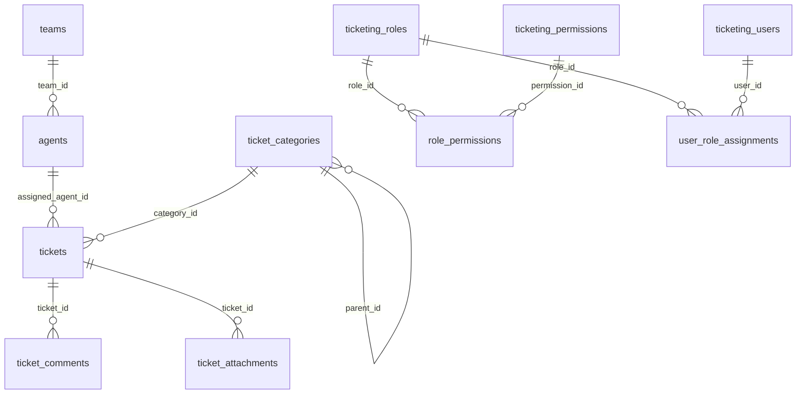

# Ticketing API Entity Relationship Diagram

This is the schema in `internal/ent/schema` and the versioned migrations `20261116090000_baseline.sql` and `20261116090100_phase0.sql`. Tables that do not exist yet are listed at the end with the sprint that adds them.

Conventions:

- UUID primary keys, except `role_permissions`, which uses a bigint identity.
- `tenant_id uuid NOT NULL` on every tenant table. Tenants live in auth-api, so `tenant_id` has no foreign key.
- Timestamps are `timestamptz`. Soft deletes use `deleted_at` where a table has it.
- User ids (`customer_id`, `author_id`, `uploaded_by`, `user_id`, `auth_service_user_id`) are auth-api user ids with no foreign key.
- Production also has the `pg_trgm` and `uuid-ossp` extensions. No column uses pgvector.

`ticket_sequences`, `sla_policies`, `routing_rules`, `kb_articles` and `outbox_events` stand alone and relate by `tenant_id` only. `tickets.assigned_team_id` and `ticket_attachments.comment_id` are plain columns with no foreign key.

## Tickets

### tickets

| Column | Type | Notes |
|---|---|---|
| `id` | uuid | Primary key |
| `tenant_id` | uuid | Not null |
| `ticket_number` | varchar | Not null, `TKT-000001` style, unique per tenant |
| `customer_id` | uuid | Not null. The requester's auth user id, or a synthetic id for public and internal requesters |
| `assigned_agent_id` | uuid | FK `agents.id`, on delete set null |
| `assigned_team_id` | uuid | Team id, no FK |
| `category_id` | uuid | FK `ticket_categories.id`, on delete set null |
| `subject` | varchar | Not null |
| `description` | text | Not null |
| `status` | varchar | Default `new`. `new`, `open`, `in_progress`, `pending_customer`, `pending_internal`, `resolved`, `closed`, `cancelled` |
| `priority` | varchar | Default `normal`. `low`, `normal`, `high`, `urgent`, `critical` |
| `channel` | varchar | Default `web`. `web`, `email`, `api`, `chat`, `whatsapp`, `phone`, `internal` |
| `order_id` | uuid | Order reference in another service |
| `external_reference` | varchar | Caller's reference |
| `crm_contact_id`, `crm_lead_id` | uuid | marketflow CRM references |
| `sla_response_due_at`, `sla_resolution_due_at` | timestamptz | SLA deadlines |
| `sla_response_breached`, `sla_resolution_breached` | boolean | Default false |
| `first_response_at`, `resolved_at`, `closed_at`, `reopened_at` | timestamptz | Lifecycle times |
| `escalation_level` | bigint | Default 0. Not written yet (sprint 10) |
| `escalated_at` | timestamptz | Not written yet (sprint 10) |
| `tags` | jsonb | String list |
| `metadata` | jsonb | Requester contact (`requester_name`, `requester_email`, `requester_phone`), `source`, `source_ref`, `category`, `contact_hash` |
| `created_at`, `updated_at`, `deleted_at` | timestamptz | |

Indexes:

| Index | Columns |
|---|---|
| `ticket_tenant_id_ticket_number` | Unique `(tenant_id, ticket_number)`. Per-tenant ticket numbers; replaced the old global unique index on `ticket_number`. |
| `ticket_tenant_source_ref` | Unique expression index `(tenant_id, metadata->>'source', metadata->'source_ref'->>'type', metadata->'source_ref'->>'id')` where `metadata->'source_ref'->>'id' IS NOT NULL`. The internal create idempotency key. It exists only in the migration, since Ent cannot declare expression indexes. |
| `ticket_tenant_id_status`, `ticket_tenant_id_priority`, `ticket_tenant_id_customer_id`, `ticket_tenant_id_assigned_agent_id`, `ticket_tenant_id_assigned_team_id` | Tenant filters |
| `ticket_category_id`, `ticket_order_id`, `ticket_crm_contact_id`, `ticket_crm_lead_id`, `ticket_external_reference` | Lookups |
| `ticket_sla_response_due_at`, `ticket_sla_resolution_due_at` | Breach scan |
| `ticket_created_at`, `ticket_deleted_at` | |

### ticket_sequences

One counter row per tenant. The create transaction claims the next number with `INSERT ... ON CONFLICT (tenant_id) DO UPDATE ... RETURNING next_value`.

| Column | Type | Notes |
|---|---|---|
| `id` | uuid | Primary key |
| `tenant_id` | uuid | Not null, unique (`ticket_sequences_tenant_id_key`) |
| `next_value` | bigint | Default 0. The last number handed out |
| `updated_at` | timestamptz | |

### ticket_comments

| Column | Type | Notes |
|---|---|---|
| `id` | uuid | Primary key |
| `tenant_id` | uuid | Not null. Added in phase 0 and backfilled from the parent ticket |
| `ticket_id` | uuid | FK `tickets.id` |
| `author_id` | uuid | From the caller's token |
| `author_type` | varchar | Default `agent` |
| `comment_type` | varchar | Default `public`. `public`, `internal`, `system` |
| `content` | text | Not null |
| `content_html` | text | |
| `is_edited`, `edited_at` | boolean, timestamptz | |
| `mentions` | jsonb | Not filled yet (sprint 9) |
| `metadata` | jsonb | |
| `created_at`, `deleted_at` | timestamptz | |

Indexes: `ticketcomment_tenant_id_ticket_id`, `ticketcomment_ticket_id_created_at`, `ticketcomment_ticket_id_comment_type`, `ticketcomment_author_id`, `ticketcomment_deleted_at`.

### ticket_attachments

Records only. Upload, signed URLs and delete arrive in sprint 9.

| Column | Type | Notes |
|---|---|---|
| `id` | uuid | Primary key |
| `tenant_id` | uuid | Not null. Added in phase 0 and backfilled from the parent ticket |
| `ticket_id` | uuid | FK `tickets.id` |
| `comment_id` | uuid | Optional, no FK |
| `uploaded_by` | uuid | Not null |
| `filename`, `storage_key`, `content_type` | varchar | Not null |
| `file_size` | bigint | Not null |
| `url`, `url_expires_at` | varchar, timestamptz | |
| `metadata` | jsonb | |
| `created_at`, `deleted_at` | timestamptz | |

Indexes: `ticketattachment_tenant_id_ticket_id`, `ticketattachment_ticket_id`, `ticketattachment_comment_id`, `ticketattachment_uploaded_by`, `ticketattachment_deleted_at`.

### ticket_categories

| Column | Type | Notes |
|---|---|---|
| `id` | uuid | Primary key |
| `tenant_id` | uuid | Not null |
| `parent_id` | uuid | FK `ticket_categories.id`, on delete set null |
| `name`, `slug` | varchar | Not null, slug unique per tenant |
| `description` | text | |
| `icon` | varchar | |
| `sort_order` | bigint | Default 0 |
| `is_active` | boolean | Default true |
| `default_assignee_id` | uuid | |
| `created_at`, `updated_at` | timestamptz | |

## Agents and teams

### teams

| Column | Type | Notes |
|---|---|---|
| `id` | uuid | Primary key |
| `tenant_id` | uuid | Not null |
| `name` | varchar | Not null, unique per tenant |
| `description` | text | |
| `is_active` | boolean | Default true |
| `metadata` | jsonb | |
| `created_at`, `updated_at`, `deleted_at` | timestamptz | |

### agents

| Column | Type | Notes |
|---|---|---|
| `id` | uuid | Primary key |
| `tenant_id` | uuid | Not null |
| `user_id` | uuid | Auth user. Unique per tenant (`agent_tenant_id_user_id`); the old global unique index was dropped in phase 0, so one person can be an agent in several tenants |
| `team_id` | uuid | FK `teams.id`, on delete set null |
| `display_name`, `email` | varchar | Not null |
| `avatar_url` | varchar | |
| `role` | varchar | Default `agent`. `agent`, `supervisor`, `admin` |
| `status` | varchar | Default `offline` |
| `max_concurrent_tickets`, `current_ticket_count` | bigint | Defaults 10 and 0 |
| `skills`, `metadata` | jsonb | |
| `is_active` | boolean | Default true |
| `last_active_at`, `created_at`, `updated_at` | timestamptz | |

## Local RBAC

### ticketing_permissions

The fixed catalogue, 108 codes, upserted on every API start.

| Column | Type | Notes |
|---|---|---|
| `id` | uuid | Primary key |
| `permission_code` | varchar | Unique, `ticketing.{module}.{action}` |
| `module`, `action` | varchar | Indexed together |
| `resource` | varchar | |
| `description` | text | |
| `created_at` | timestamptz | |

### ticketing_roles

| Column | Type | Notes |
|---|---|---|
| `id` | uuid | Primary key |
| `tenant_id` | uuid | Not null |
| `role_code` | varchar | Unique per tenant. System roles `ticketing_admin`, `supervisor`, `agent`, `customer` |
| `name` | varchar | |
| `description` | text | |
| `is_system_role` | boolean | Default false |
| `created_at`, `updated_at` | timestamptz | |

### role_permissions

| Column | Type | Notes |
|---|---|---|
| `id` | bigint identity | Primary key |
| `role_id` | uuid | FK `ticketing_roles.id`, on delete cascade |
| `permission_id` | uuid | FK `ticketing_permissions.id`, on delete cascade |

Unique `(role_id, permission_id)`.

### ticketing_users

One row per auth user per tenant, created just in time at sign-in or from `auth.user.*` events.

| Column | Type | Notes |
|---|---|---|
| `id` | uuid | Primary key |
| `tenant_id` | uuid | Not null |
| `auth_service_user_id` | uuid | Unique per tenant, also indexed alone |
| `email`, `name` | varchar | |
| `sync_status` | varchar | Default `synced` |
| `last_sync_at`, `created_at`, `updated_at` | timestamptz | |

### user_role_assignments

| Column | Type | Notes |
|---|---|---|
| `id` | uuid | Primary key |
| `tenant_id` | uuid | Not null |
| `user_id` | uuid | FK `ticketing_users.id`, on delete cascade |
| `role_id` | uuid | FK `ticketing_roles.id`, on delete cascade |
| `assigned_by` | uuid | Not null |
| `assigned_at` | timestamptz | |
| `expires_at` | timestamptz | |

Unique `(tenant_id, user_id, role_id)`.

## SLA and routing

### sla_policies

| Column | Type | Notes |
|---|---|---|
| `id` | uuid | Primary key |
| `tenant_id` | uuid | Not null |
| `name` | varchar | |
| `description` | text | |
| `priority` | varchar | Matched against the ticket priority |
| `category_id` | uuid | Optional category match, no FK |
| `first_response_minutes`, `resolution_minutes` | bigint | Targets |
| `first_response_business_hours`, `resolution_business_hours` | boolean | Default true. Stored, not applied yet (sprint 10) |
| `business_hours` | jsonb | Stored, not applied yet (sprint 10) |
| `is_active` | boolean | Default true |
| `sort_order` | bigint | |
| `metadata` | jsonb | |
| `created_at`, `updated_at` | timestamptz | |

### routing_rules

| Column | Type | Notes |
|---|---|---|
| `id` | uuid | Primary key |
| `tenant_id` | uuid | Not null |
| `name` | varchar | |
| `description` | text | |
| `is_active` | boolean | Default true |
| `sort_order` | bigint | Evaluation order |
| `conditions` | jsonb | Not null |
| `action` | jsonb | Not null. `assign_team`, `assign_agent` or `set_priority` |
| `created_at`, `updated_at` | timestamptz | |

## Knowledge base

### kb_articles

| Column | Type | Notes |
|---|---|---|
| `id` | uuid | Primary key |
| `tenant_id` | uuid | Not null |
| `author_id` | uuid | Not null |
| `title`, `slug` | varchar | Slug unique per tenant |
| `content` | text | |
| `excerpt`, `category` | varchar | Category is free text |
| `tags` | jsonb | |
| `status` | varchar | Default `draft` |
| `is_public` | boolean | Default true |
| `view_count`, `helpful_count`, `not_helpful_count` | bigint | Updated scoped by tenant |
| `metadata` | jsonb | |
| `published_at`, `created_at`, `updated_at`, `deleted_at` | timestamptz | |

## Events

### outbox_events

| Column | Type | Notes |
|---|---|---|
| `id` | uuid | Primary key |
| `tenant_id` | uuid | |
| `aggregate_type`, `event_type` | varchar | |
| `aggregate_id` | uuid | |
| `payload` | bytea | |
| `status` | varchar | Default `PENDING` |
| `attempts` | bigint | |
| `last_attempt_at`, `published_at`, `created_at` | timestamptz | |
| `error_message` | varchar | |

`atlas_schema_revisions` records applied migration files and is managed by `ticketing-migrate`.

## Planned tables

| Table or column | Purpose | Sprint |
|---|---|---|
| Generated `tsvector` columns with GIN indexes on `tickets` and `kb_articles` (or `pg_trgm` indexes) | Full-text search | 9 |
| `ticket_views` | Saved views and filters per agent | 9 |
| `macros` | Canned replies that set fields | 9 |
| A `related` link between tickets | Merge and parent-child | 9 |
| Business-hours calendars and holidays | SLA clocks | 10 |
| Ticket rollup tables (hourly and daily) | Analytics | 12 |
| `csat_responses` | CSAT scores | 12 |

## Maintenance

After changing an Ent schema I run `go generate ./internal/ent`, add a versioned migration in `internal/ent/migrate/migrations` with its `atlas.sum` entry, and update this page.
